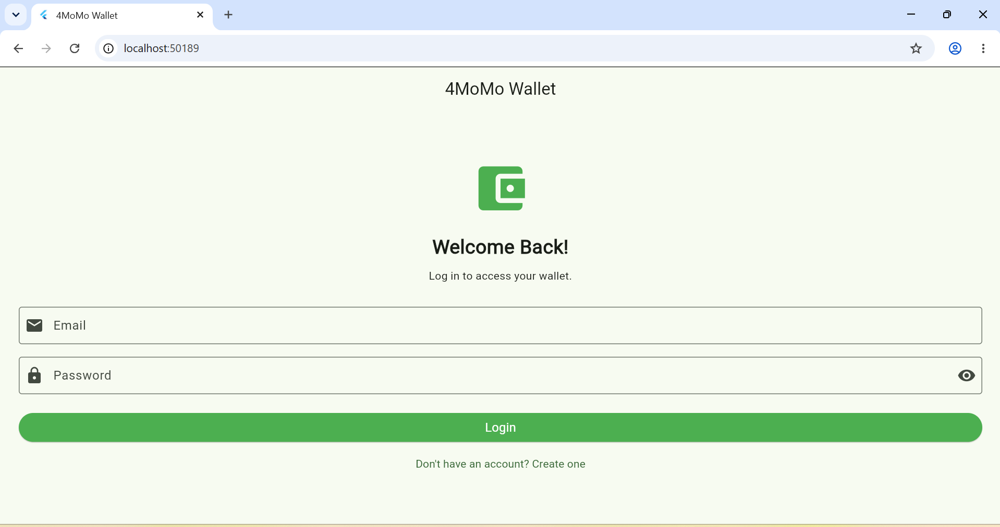
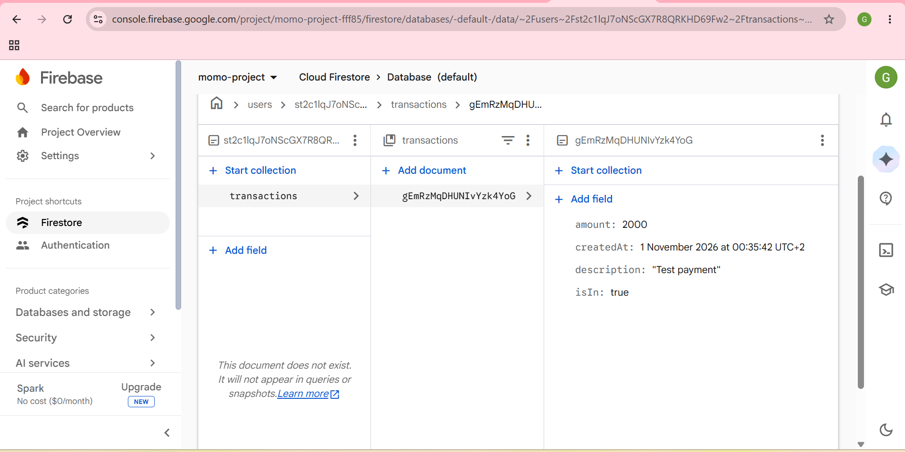
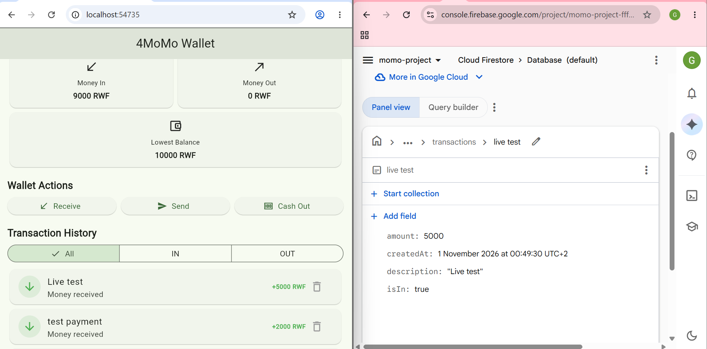
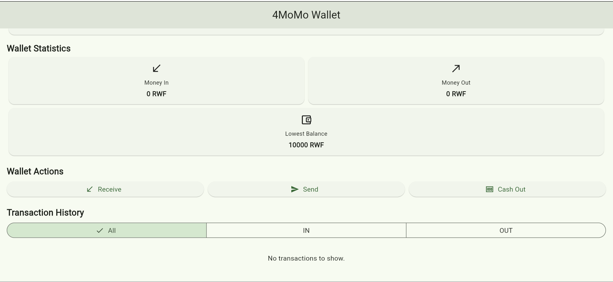

# 4MoMo Wallet

A simple mobile wallet application built with Flutter and Dart. Users can receive money, send money, and cash out while keeping track of their transactions.

## Technologies Used

- Flutter
- Dart
- Firebase Authentication
- Cloud Firestore

## Features

- User registration and login using Firebase Authentication.
- Each user's transactions are stored separately in Firestore under their unique user ID.
- Real-time transaction updates from Firestore.
- Add, edit, and delete transactions.
- Wallet balance and transaction history.
- User data isolation: users can only access their own transactions.

## Firebase Integration

The application uses Firebase Authentication to manage user accounts and Cloud Firestore to store wallet transactions.

Each user's data is stored under:

`users/{userId}/transactions`

Firestore security rules ensure that authenticated users can only read and write their own data.

## Screenshots

### Login Screen

### Firestore Database

### Live Updates

### User Data Isolation

